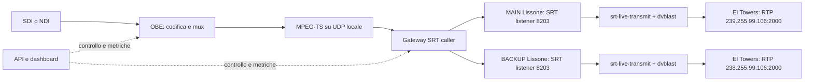

# Idee da In Aria! e confronto con OBE

Analisi del 21 ottobre 2026. Fonte: [PDF In Aria! Media Group](https://docs.inaria.media/inariamediagroup.pdf), 30 pagine; numerazione a partire dalla copertina.

Il maggiore spazio di miglioramento riguarda il trasporto e la gestione operativa. Abbiamo già una base di codifica e mux broadcast; aggiornare le librerie ne migliora la manutenzione, ma non aggiunge automaticamente una piattaforma di contribuzione remota.

## Stato verificato

La build precedente è conservata in `obe-rt-build`. Il checkout `obe-rt-build-current` contiene l'aggiornamento delle librerie, ancora in compilazione e verifica al momento di questa analisi. Le capacità individuate nel codice non equivalgono a collaudi su dispositivi reali.

| Area e riferimento nel PDF | Cosa abbiamo oggi | Idea concreta |
| --- | --- | --- |
| Codifica AVC/HEVC e audio SDI — pp. 22, 28 | x264/x265, mux MPEG-TS, ingresso DeckLink con 16 canali audio, percorsi NDI e V4L2. Presenti anche SCTE-35, teletext e SMPTE 2038. | Conservare questa base e verificarne continuità audio/video e dati ausiliari dopo gli aggiornamenti. |
| SRT e trasporto proprietario con ARQ/FEC — pp. 15–16 | Uscite UDP/RTP. Nella configurazione FFmpeg corrente SRT e RIST risultano disabilitati. | Aggiungere un gateway SRT con riconnessione, cifratura configurabile e metriche; valutare FEC separatamente su perdite misurate. |
| Contribuzione punto-multipunto — pp. 16–17 | OBE gestisce già più destinazioni di uscita; manca la gestione di nodi e percorsi remoti. | Destinazioni configurabili e monitorate singolarmente, con code limitate: un ricevitore guasto non deve bloccare gli altri. |
| Gestione web e monitoraggio remoto — pp. 16, 18 | CLI, statistiche locali; codice HTTP/SSE e miniature presente ma `LTN_WS_ENABLE=0`. | Servizio di controllo con API, stato dei processi, configurazioni persistenti, dashboard e allarmi. La riattivazione del vecchio modulo web da sola non realizza questo servizio. |
| Aggregazione di collegamenti mobili — pp. 22–23, 27 | Nessun bonding o controllo dei percorsi WAN individuato nel trasporto OBE esaminato. | Prima failover tra due connessioni con tempi misurati; poi duplicazione e selezione dei pacchetti o aggregazione con ricevitore compatibile. Più uscite UDP non sommano automaticamente la banda. |
| Gateway encoder/decoder e canali di ritorno — pp. 17, 27–28 | OBE è orientato alla codifica; l'ingresso `url` viene esplicitamente rifiutato. L'utente ha già verificato una catena ricevente esterna con `srt-live-transmit` e `dvblast`. | Integrare prima i ricevitori di Lissone e il ritorno esistenti. Per nuove uscite SDI serve una decodifica separata; i decoder usati per leggere V210 non costituiscono un ricevitore di contribuzione completo. |
| 16 video sincronizzati e genlock — pp. 26–28 | `MAX_DEVICES=1`; esistono più stream e uscite, ma non equivalgono a 16 ingressi video sincronizzati. | Gestire inizialmente processi indipendenti per canale. La sincronizzazione tra canali richiede poi clock condiviso, hardware e verifiche specifiche; aumentare la costante non basta. |
| 4K60 e accelerazione NVIDIA — pp. 22, 26 | La CLI propone formati fino a 1080p60. Il percorso NVENC esiste nel sorgente, ma gli encoder NVENC della build FFmpeg corrente sono disabilitati. | Trattare UHD/GPU come un'estensione dell'intera catena: acquisizione, conversioni, codifica, mux, driver e carico sostenuto. |
| Anteprime WebRTC — p. 27 | Esistono funzioni per miniature JPEG, senza una regia web attiva. | Avviare l'anteprima a bassa risoluzione in un processo dedicato; verificare che non aumenti code e latenza dell'uscita principale. |

## Vincolo di compatibilità: Uno4 / Canale 40 → Lissone → EI Towers

I dati seguenti sono stati forniti dall'utente il 21 ottobre 2026, sulla base di log, appunti e schema Excel. Non sono un capitolato ufficiale EI Towers né misure eseguite in questa analisi. La catena software verificata dall'utente comprende `srt-live-transmit` e `dvblast`; non è quindi necessario progettare un nuovo decoder per la prima integrazione. Un remux può cambiare tabelle e PID senza decodificare il video. Marca, modello e firmware di eventuali apparati hardware restano sconosciuti.

| Tratto | Configurazione riferita | Conseguenza per il progetto |
| --- | --- | --- |
| Ingresso ai server di Lissone | SRT, listener sulla porta `8203`, passphrase presente, latenza configurata `400 ms` | Il mittente si collega come caller. Rilevare versioni e opzioni effettive prima del collaudo; i 400 ms non rappresentano la latenza complessiva audio/video. La passphrase non va inserita nella documentazione. |
| MAIN → EI Towers | MPEG-TS su RTP/UDP multicast `239.255.99.106:2000` | Conservare destinazione e incapsulamento RTP; rilevare anche interfaccia, indirizzo sorgente, TTL, dimensione dei datagrammi e ritmo di invio. |
| BACKUP → EI Towers | MPEG-TS su RTP/UDP multicast `238.255.99.106:2000` | Conservare l'indirizzo esattamente come fornito e collaudare il percorso separatamente. |
| Return feed | SRT, listener sulla porta `9203` | Mantenere il ritorno come percorso distinto; identificare il punto di prelievo per capire quale tratto della catena consente di controllare. |

Il MAIN usa Ubuntu 20.04.3 LTS; le versioni di `srt-live-transmit` e `dvblast` non sono state rilevate. L'aggiornamento isolato delle librerie OBE non aggiorna automaticamente questi ricevitori.

| Contenuto / identità | Dato disponibile e provenienza | Riscontro in OBE e verifica necessaria |
| --- | --- | --- |
| Video | H.264 / AVC, log MAIN | Percorso AVC presente. Conservare il codec e rilevare risoluzione, fps, scansione, profilo, livello, formato colore, bitrate, VBV e GOP dal segnale di riferimento. |
| Audio | MPEG-2 Audio, ISO/IEC 13818-3, log MAIN | OBE dispone di MP2/TwoLAME, ma la dicitura del log non prova il layer effettivo. Confermare dagli header audio layer/versione, frequenza, canali e bitrate prima di scegliere `format=mp2`. |
| Rapporto d'aspetto | 16:9, appunti encoder | Opzione `aspect-ratio` presente; verificare il rapporto visualizzato e la segnalazione SAR/DAR effettiva. |
| Organizzazione | SPTS, schema Excel | Il mux OBE imposta un solo programma (`params.num_programs = 1`). |
| TSID | `43009`, Excel | Configurabile con `ts-id`. |
| SID / Program Number | `9909`, Excel e log | Configurabile con `program-num`. |
| PMT PID | `209`, Excel | Configurabile con `pmt-pid`. |
| Video / PCR PID | `990`, Excel; PID video confermato nei log | PID dello stream video e `pcr-pid` configurabili separatamente; verificare anche la posizione reale del PCR. |
| Audio PID | `991`, Excel e log; secondo audio `992`, solo Excel | `pid` configurabile per stream. Verificare presenza e contenuto del secondo audio prima di aggiungerlo alla PMT. |
| ONID | `8572`, Excel | Non esposto dalla CLI OBE. Il mux non valorizza `network_id`; libmpegts usa il default `0xff01` per l'ONID nella SDT. Va verificato se il remux a valle lo riscrive. |
| LCN | `14`, Excel, da riconfermare per Uno4 | Non esposto dalla CLI OBE. Individuare il componente che genera la segnalazione LCN; non dedurre il valore dal nome «Canale 40». |

**Questi identificativi descrivono la consegna documentata, ma non provano che siano uguali all'ingresso SRT.** Prima di impostarli in OBE bisogna verificare quali PID e tabelle `dvblast` conserva, seleziona o riscrive. Per ONID, LCN e tabelle SI va assegnata una responsabilità esplicita al componente già incaricato. Se ONID 8572 serve anche all'uscita OBE, occorre una piccola estensione verificata della configurazione del mux: cambiare solo TSID e SID non lo imposta.

Restano da rilevare bitrate video/audio/TS, CBR o VBR, GOP e tempi di acquisizione, parametri audio/video dettagliati, tabelle PAT/PMT/SDT/NIT/EIT effettivamente presenti, loro periodicità, descrittori e vincoli PCR/PTS. Anche gli eventuali teletext, sottotitoli e dati ausiliari vanno inventariati. DVB-T2 descrive la distribuzione a valle e non determina da solo il formato accettato all'ingresso della catena di contribuzione.

## Ordine di implementazione consigliato

**0. Rilevare il profilo attuale e congelare una base riproducibile.** Registrare versioni e configurazioni effettive di OBE, `srt-live-transmit` e `dvblast`, revisioni delle librerie, patch e immagine Docker. Confrontare campioni del contributo ricevuto e della consegna RTP, mantenendo separati i profili dei due punti. Un'analisi degli stream con `ffprobe` e un'analisi delle tabelle/temporizzazioni TS hanno ruoli complementari: il solo riconoscimento di H.264 non dimostra interoperabilità. Completare le prove software della build aggiornata e conservare la build precedente e le configurazioni di ritorno. Il risultato è un profilo di compatibilità basato su misure; i campi sconosciuti restano tali, senza assumere 1080i, stereo a 48 kHz o bitrate predefiniti.

**1. Prima versione: OBE verso i ricevitori SRT esistenti e stato operativo.** Alimentare un gateway SRT dall'uscita MPEG-TS locale di OBE, usando H.264 e il profilo audio verificato nella fase 0. Collegarlo come caller ai listener MAIN e BACKUP sulla porta 8203, senza introdurre ricodifica nei gateway. Mantenere `srt-live-transmit` e `dvblast` nella catena ricevente e verificare il loro incapsulamento locale. Gestire avvio, arresto, riconnessione, stato delle destinazioni e misure di bitrate, RTT, ritrasmissioni e perdite residue. API e dashboard devono offrire il profilo collaudato come preset versionato, con validazione dei parametri; cambi di codec, PID e identità del servizio richiedono un nuovo collaudo.

Lo schema rappresenta l'integrazione proposta con i ricevitori esistenti; indirizzi dei server e collegamenti locali tra processi restano da rilevare. L'uscita UDP locale semplifica la prima integrazione, ma va controllata per overflow del socket. Se diventa un collo di bottiglia, valutare un collegamento interno con pressione di ritorno e limiti espliciti. Conservare i byte del TS non garantisce da solo il corretto ritmo di consegna, il jitter o la temporizzazione PCR.

**2. Affidabilità misurata.** Introdurre profili di latenza, allarmi persistenti, ripartenza dei processi e failover WAN. In un laboratorio Docker isolato, simulare ritardo, jitter, riordino e perdite a raffica. Misurare errori di continuità TS, PCR/PTS, interruzioni audio/video, tempo di recupero, CPU e memoria. Una prova di 24 ore senza crescita delle code è un criterio iniziale utile, non una certificazione broadcast.

Il collaudo deve attraversare entrambi i percorsi reali di Lissone e la consegna a EI Towers. Confrontare con il riferimento codec, identità, PID, numero di tracce, tabelle e descrittori; analizzare continuità, PCR, PTS/DTS e sincronismo audio/video. Le catture con temporizzazione servono a valutare anche la consegna in rete: un file TS da solo non basta. Includere controlli pertinenti di ETSI TR 101 290 e stabilire soglie di accettazione con il destinatario. Verificare perdita dell'ingresso, riavvio e passaggio MAIN/BACKUP, misurando il tempo di riaggancio; due destinazioni attive non dimostrano una commutazione senza interruzioni. Il return feed aiuta il controllo solo del tratto effettivamente incluso nel suo punto di prelievo. La messa in servizio dipende dall'esito di questo collaudo.

**3. Espansione.** Aggiungere anteprime e gestione di più canali; ricezione/decodifica aggiuntiva solo per nuove uscite che la richiedano. HEVC, UHD, GPU, bonding e sincronizzazione tra ingressi restano sviluppi separati, con nuovi profili e prove di compatibilità. Il profilo Uno4 verso EI Towers mantiene H.264 e i parametri collaudati. Le migliorie alla gestione possono arrivare senza cambiare il formato consegnato.

## Evidenze nel repository

- Formati HD, profili di latenza e uscite: [obecli.c](/root/code/ott-broadcast-encoder/obe-rt-build-current/obe-rt/obe/obecli.c:85).
- Limite di un dispositivo e 16 canali audio: [common.h](/root/code/ott-broadcast-encoder/obe-rt-build-current/obe-rt/common/common.h:58); acquisizione audio: [decklink.cpp](/root/code/ott-broadcast-encoder/obe-rt-build-current/obe-rt/input/sdi/decklink/decklink.cpp:3079).
- Ingresso URL non supportato: [obe.c](/root/code/ott-broadcast-encoder/obe-rt-build-current/obe-rt/obe/obe.c:754); più destinazioni gestite da `obe_setup_output`, nello stesso file.
- Componente web disabilitata: [ltn_ws.h](/root/code/ott-broadcast-encoder/obe-rt-build-current/obe-rt/obe/ltn_ws.h:7). Le statistiche esistenti sono prodotte da `runtime_statistics_thread` in `obecli.c`.
- Dati broadcast nel mux: [ts.c](/root/code/ott-broadcast-encoder/obe-rt-build-current/obe-rt/mux/ts/ts.c:313).
- Parametri TS esposti dalla CLI: [obecli.c](/root/code/ott-broadcast-encoder/obe-rt-build-current/obe-rt/obe/obecli.c:276); mux a programma singolo e identificativi: [ts.c](/root/code/ott-broadcast-encoder/obe-rt-build-current/obe-rt/mux/ts/ts.c:562).
- ONID di default: [common.h](/root/code/ott-broadcast-encoder/obe-rt-build-current/libmpegts-obe/common.h:77), selezionato in [libmpegts.c](/root/code/ott-broadcast-encoder/obe-rt-build-current/libmpegts-obe/libmpegts.c:1408) e scritto nella SDT in [dvb.c](/root/code/ott-broadcast-encoder/obe-rt-build-current/libmpegts-obe/dvb/dvb.c:239).
- Uscita RTP MPEG-TS: [ip.c](/root/code/ott-broadcast-encoder/obe-rt-build-current/obe-rt/output/ip/ip.c:35); encoder MP2: [twolame.c](/root/code/ott-broadcast-encoder/obe-rt-build-current/obe-rt/encoders/audio/mp2/twolame.c:102).
- Configurazione generata FFmpeg: [config_components.h](/root/code/ott-broadcast-encoder/obe-rt-build-current/ffmpeg/config_components.h:2291), con `CONFIG_LIBRIST_PROTOCOL=0` e `CONFIG_LIBSRT_PROTOCOL=0`; anche `CONFIG_H264_NVENC_ENCODER` e `CONFIG_HEVC_NVENC_ENCODER` sono a zero.

Il PDF riporta una latenza minima di 400 ms e superiorità rispetto a SRT, ma non fornisce un benchmark riproducibile per confrontare quei risultati con la nostra build. Inoltre lo schema mescola riferimenti v8/v9: non è una specifica sufficiente per riprodurre il protocollo proprietario. Le raccomandazioni sopra sono proposte di progetto, non funzionalità già implementate né promesse di equivalenza.

Verifica svolta: lettura del PDF e ricerche mirate nei due checkout, nelle configurazioni e nello stato dei container. Per questa analisi è stato aggiunto soltanto il presente documento; nessun nuovo servizio o protocollo è stato installato.
