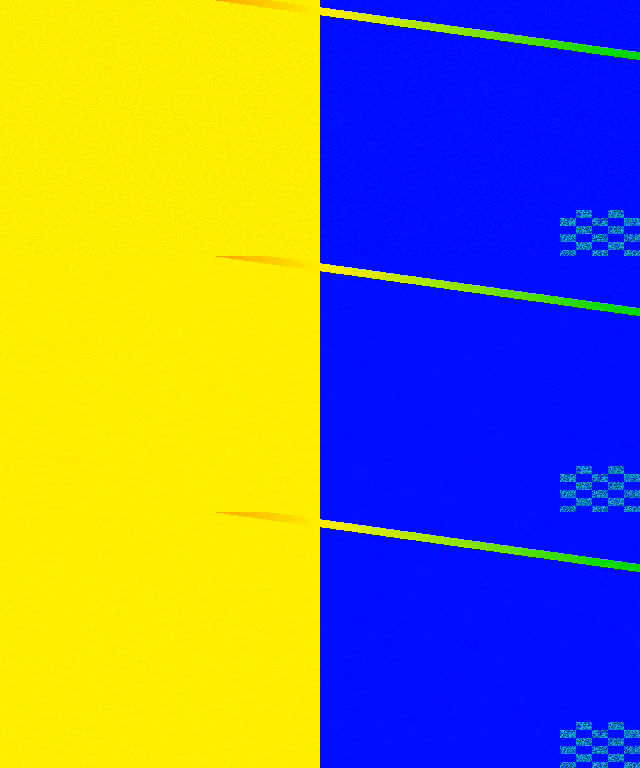

# Benchmark qualità e compressione AVC

Primo banco riproducibile 1080i50 sulla pipeline reale OBE. La selezione riguarda
candidati per il laboratorio; il profilo del pannello e l'encoder in onda non
vengono modificati. Corpus del playout, macchina finale, latenza e prova di durata
restano necessari per scegliere il profilo operativo.

## Scelta iniziale dei profili HD

**Candidato principale: `veryfast`, video 8 Mbit/s, mux 9,5 Mbit/s.**
**Candidato a banda ridotta: `veryfast`, video 6 Mbit/s, mux 7,5 Mbit/s.**
Entrambi superano due acquisizioni complete e le soglie del banco. Il secondo
risparmia il **21,1% di banda TS**, con circa **0,80 dB di PSNR** e **0,00208 di
SSIM** in meno sul pattern. Non è un risparmio a qualità identica.

| Profilo candidato | Video / mux kbit/s | VBV kbit | AVC effettivo medio Mbit/s | SSIM nelle due prove | CPU p95 peggiore | Coda max |
| --- | --- | ---: | ---: | --- | ---: | ---: |
| HD di riferimento | 8000 / 9500 | 8000 | 5,946 | 0,951995–0,952116 | 411,9% | 6 |
| HD a banda ridotta | 6000 / 7500 | 6000 | 4,398 | 0,949809–0,950144 | 392,9% | 5 |

Parametri comuni: GOP 50, B-frame 2, lookahead 20, thread 4, MP2 stereo
192 kbit/s; input nativo 1080i50 TFF e speedcontrol OBE `generic` attivo.
Il primo profilo usa il 17,4% di banda TS in meno rispetto al candidato da
10 Mbit/s video, al costo di circa 0,61 dB nella prima passata. La scelta di
8 Mbit/s è un punto di partenza per il pilota, non un ottimo universale.

`faster` non mostra un vantaggio di qualità/compressione ripetibile su questo
pattern: a 8 Mbit/s gli intervalli SSIM si sovrappongono e gli scarti sono
paragonabili alla variabilità fra prove. `medium` non migliora gli score a
queste condizioni. Rimane `veryfast` come riferimento, senza attribuirgli una
superiorità percettiva generale o un vantaggio CPU non dimostrato.

## Correzione emersa dal benchmark

Il core ignorava `preset` quando `tuning` non era specificato: nel percorso
`generic`, `obe_populate_avc_encoder_params()` chiamava `x264_param_default()`.
Le prime acquisizioni `veryfast`, `faster` e `medium` avevano gli stessi parametri
SEI, quindi non consentivano una selezione fra i tre preset.

Il commit core `209e080` applica il preset anche senza tuning, conservando gli
adattamenti OBE e i due modi a bassa latenza. Il test usa la funzione OBE reale
con 21 combinazioni: fallisce prima della correzione e passa dopo. La patch
`0017-obe-avc-preset.patch` porta la correzione anche nelle nuove build.
Il controllo mirato si esegue nel builder con `bash tests/avc-preset.sh`.

La matrice utile alla scelta viene eseguita con il binario corretto in una nuova
directory. **Ricompilare cambia il comportamento dei preset senza tuning**;
un profilo operativo esistente deve essere verificato prima di sostituire il
binario. Il benchmark non distribuisce automaticamente il nuovo eseguibile.

## Metodo

`tests/encoding-benchmark.py` serve un MPEG-TS mediante HTTP su loopback e avvia
un'istanza privata del backend: `HTTP → OBE → AVC/MP2 → MPEG-TS/UDP → acquisizione`.
Il servizio webpanel esistente non viene contattato. Il lettore URL di OBE
regola la consegna dei frame sul clock del contenuto.

- Sorgente: 30 secondi, 1920×1080, 25 frame/50 campi al secondo, TFF, YUV 4:2:0
  a 8 bit, BT.709, range limitato, SAR 1:1; MP2 stereo 48 kHz, 192 kbit/s.
- Movimento `testsrc2` a 50 Hz, rumore deterministico dal secondo 18 e marker
  binari distinti per campo, applicati prima dell'interlacciamento.
- Contribuzione MPEG-2 `q:v=2`. Il riferimento è **la contribuzione decodificata**:
  gli score misurano il danno aggiunto da OBE, senza attribuirgli quello del MPEG-2.
- Finestra identica per ogni candidato: frame 350–549, secondi 14–22, ossia
  200 frame/400 campi. Il controllo dei pixel rifiuta campi persi, duplicati,
  scambiati e non allineati; vengono verificati anche PTS, formato e colore.
- Entrambi i rami sono ritagliati a `1920×984`, escludendo le prime 96 righe
  contenenti il marker, poi separati in campi. Nessun deinterlacciamento o scaling.
  PSNR e SSIM FFmpeg confrontano esattamente 400 campi; log per campo conservati.
- Il bitrate AVC deriva dalle dimensioni dei 200 pacchetti/frame selezionati.
  Il bitrate TS deriva da distanza fra pacchetti e PCR; stuffing calcolato sullo
  stesso intervallo PCR, che copre l'acquisizione e non soltanto gli otto secondi.
- Telemetria CPU/RSS, frame/s e coda campionata ogni secondo nel tratto centrale
  della codifica, includendo la finestra di qualità. CPU 100% equivale a un core.

Controlli del misuratore: confronto identico → SSIM 1 e PSNR infinito; rumore
aggiunto sul solo ramo di test → degradazione riconosciuta. I test unitari
verificano allineamento, rifiuto di marker ambigui, bitrate/stuffing, wrap PCR e
discontinuità. I media e i log rimangono sotto `tests/.build/`, fuori da Git.

### Tentativi preliminari conservati

| Tentativo | Esito | Conseguenza |
| --- | --- | --- |
| Contribuzione UDP dal generatore, buffer predefinito | Overrun durante il passaggio al rumore e riconnessione | Acquisizione scartata |
| Buffer UDP aumentato, due tentativi | Coda in crescita e arresto `ENOBUFS` prima della finestra utile | Acquisizioni scartate; il trasporto richiede una verifica separata |
| Sorgente HTTP, binario precedente | Allineamento valido, ma parametri identici fra preset | Dati esclusi dalla selezione dei preset; aggiunto test di regressione |
| Sorgente HTTP, core corretto | Nuova matrice con sorgente, parametri e ambiente congelati | Unica base per la selezione descritta nel rapporto |

I primi tre tentativi precedono la correzione del preset e restano nelle
directory `encoding-benchmark-20261021-{smoke,buffer,recheck,http}` sotto
`tests/.build/`. Non dimostrano il comportamento UDP del binario corretto.

## Matrice e parametri

Preset `veryfast`, `faster`, `medium`; video 4, 6, 8 e 10 Mbit/s; mux CBR pari
al video nominale più 1,5 Mbit/s. VBV pari a un secondo di video, GOP 50,
B-frame 2, lookahead richiesto 20, thread richiesti 4, MP2 192 kbit/s.
Questi parametri restano fissi: questa prima matrice confronta preset e bitrate,
non ottimizza indipendentemente GOP, AQ/psy o lookahead.

OBE `generic` abilita lo **speedcontrol adattivo**: il nome del preset non
descrive tutte le impostazioni effettive durante il flusso. Il runner registra
il SEI x264 iniziale in `x264-settings.txt`, comprese reference, AQ/psy, VBV e
lookahead effettivi; non misura tutte le successive variazioni dello speedcontrol.
Un confronto rigoroso di preset statici richiederebbe una prova separata.

Parametri iniziali verificati nei bitstream dopo la correzione:

| Preset richiesto | subme | mixed_ref | trellis | chroma_qp_offset |
| --- | ---: | ---: | ---: | ---: |
| veryfast | 2 | 0 | 0 | 0 |
| faster | 4 | 0 | 1 | 0 |
| medium | 7 | 1 | 1 | -2 |

Comuni: reference 4, lookahead 20, AQ `1:1.00`, psy-RD `1.00:0.00`, GOP aperto,
B-pyramid 2, `nal_hrd=fakevbr`, `filler=0`. L'assenza di filler AVC e la scena
spiegano perché il bitrate video medio può essere inferiore al nominale;
il mux TS resta CBR e aggiunge pacchetti nulli. Il bitrate TS determina quindi
la banda di trasporto, anche quando il video usa meno bit.

Soglie preliminari di laboratorio: mediana ≥24,5 frame/s, coda video ≤25 frame,
CPU p95 ≤480% in un container con quota 6 CPU e 8 GiB. Sono criteri per selezionare
candidati su questo host condiviso, non una garanzia real time sulla macchina finale.

## Prima matrice sul core corretto

Dodici acquisizioni valide; dieci superano anche tutte le soglie preliminari.
Ogni riga confronta gli stessi 400 campi. Valori completi e ripetizioni sono
disponibili nel [CSV](encoding-benchmark-results.csv).

| Preset | Video nominale Mbit/s | AVC misurato Mbit/s | PSNR dB | SSIM | CPU p95 % | Coda max | Soglie banco |
| --- | ---: | ---: | ---: | ---: | ---: | ---: | --- |
| veryfast | 4 | 2.857 | 36.967 | 0.946509 | 319.9 | 3 | sì |
| faster | 4 | 2.850 | 36.942 | 0.946393 | 310.9 | 0 | sì |
| medium | 4 | 2.795 | 36.782 | 0.945805 | 296.9 | 1 | sì |
| veryfast | 6 | 4.396 | 38.210 | 0.949809 | 392.9 | 5 | sì |
| faster | 6 | 4.388 | 38.209 | 0.949837 | 389.9 | 5 | sì |
| medium | 6 | 4.354 | 38.081 | 0.949230 | 387.9 | 3 | sì |
| veryfast | 8 | 5.932 | 39.012 | 0.951995 | 406.9 | 6 | sì |
| faster | 8 | 5.958 | 39.006 | 0.952085 | 408.9 | 6 | sì |
| medium | 8 | 5.938 | 38.954 | 0.951762 | 378.9 | 5 | sì |
| veryfast | 10 | 7.464 | 39.618 | 0.953672 | 422.9 | 6 | sì |
| faster | 10 | 7.430 | 39.584 | 0.953393 | 406.9 | 7 | no |
| medium | 10 | 7.448 | 39.552 | 0.953419 | 377.9 | 7 | no |

`faster` e `medium` a 10 Mbit/s hanno mediana 23,99 frame/s nei campioni
da un secondo, sotto la soglia dichiarata: non vengono promossi. La finestra
decodificata conserva tutti i campi; questo esito non dimostra da solo perdita
di frame o incapacità sostenuta. Il campionamento breve e la produzione a burst
richiedono misure più lunghe prima di formulare quel giudizio.

Host: Intel Core i7-8700, quota Docker 6 CPU, 8 GiB, rete esterna disabilitata.
FFmpeg n9.0.2; core `209e080`; runner build `7c7a0e9`; backend congelato a `d02fe79`.
La stessa copia delle dipendenze compilate viene usata per tutti i casi.
Artefatti: `tests/.build/encoding-benchmark-20261021-fixed/`.

SHA-256 del binario testato:
`0c4f0a51a7f761e2f723d50ffedd93aa9c88c7a204afac64533ad3f91743ef93`.
SHA-256 del riferimento:
`d2a860c30e8943d824d63c4405d66684a2f2dbbd5315387938e0325ee2341fc2`.

## Ripetizione dei finalisti

Tre preset a 6 e 8 Mbit/s, due acquisizioni per configurazione: tutte e sei
le ripetizioni sono valide e superano le soglie. In totale **18/18 prove valide**,
**16/18 entro tutte le soglie del banco**; le due escluse sono quelle a 10 Mbit/s
indicate sopra. Nessuna prova è stata cancellata o sostituita per migliorare gli score.

| Preset | Video nominale Mbit/s | AVC misurato Mbit/s, min–max | PSNR dB, min–max | SSIM, min–max | CPU p95 peggiore % |
| --- | ---: | --- | --- | --- | ---: |
| veryfast | 6 | 4.396–4.399 | 38.210–38.213 | 0.949809–0.950144 | 392.9 |
| faster | 6 | 4.388–4.389 | 38.209–38.210 | 0.949798–0.949837 | 389.9 |
| medium | 6 | 4.354–4.366 | 38.081–38.121 | 0.949230–0.949426 | 387.9 |
| veryfast | 8 | 5.932–5.959 | 39.004–39.012 | 0.951995–0.952116 | 411.9 |
| faster | 8 | 5.958–5.995 | 38.966–39.006 | 0.951899–0.952085 | 408.9 |
| medium | 8 | 5.899–5.938 | 38.954–38.955 | 0.951741–0.951762 | 406.9 |

Due prove mostrano la variabilità osservata, non un intervallo di confidenza.
OBE usa speedcontrol adattivo e disabilita il determinismo x264; il carico del
computer condiviso può modificare le scelte durante la codifica. Una graduatoria
con scarti di pochi decimillesimi di SSIM non giustifica da sola un cambio di preset.

Per `veryfast`, nella prima passata il tratto senza rumore ha SSIM 0,990004 /
0,992753 / 0,994704 a 6 / 8 / 10 Mbit/s; il tratto rumoroso 0,909614 /
0,911237 / 0,912640. Il rumore domina il limite dello score medio: il corpus
reale deve verificare se questo compromesso è rappresentativo del playout.

Ritaglio dello stesso semiquadro 1000 (20 secondi), senza ridimensionamento:
dall'alto riferimento, `veryfast` 6 Mbit/s e `veryfast` 8 Mbit/s, seconda prova.
Il rumore viene attenuato rispetto al riferimento; il singolo ritaglio non basta
per giudicare la qualità in movimento o classificare contenuti broadcast reali.



## Riproduzione

Usare l'immagine di build già disponibile e un `obecli` ricompilato con la
correzione `209e080`, senza installare dipendenze. Aggiornare il solo sorgente
non modifica un eseguibile compilato in precedenza:

```sh
PYTHONDONTWRITEBYTECODE=1 python3 tests/encoding-benchmark-test.py
docker run --rm --cpus=6 --memory=8g --network=none \
  --mount "type=bind,source=$PWD,target=/work" -w /work \
  -e PYTHONDONTWRITEBYTECODE=1 obe-rt-build:srt-2026-10-21 \
  python3 tests/encoding-benchmark.py \
  --directory tests/.build/encoding-benchmark-locale
```

Per un primo caso aggiungere `--presets veryfast --bitrates 8000`; per riprendere
la matrice usare `--resume`. `--repeats 2` o `3` aggiunge ripetizioni dei preset e
bitrate selezionati. Un risultato non valido resta conservato: riprovare in una
nuova directory. `--fixture-only` esegue soltanto generatore e controlli qualità.

`environment.json` identifica sorgente, binario, runner, backend, launcher,
FFmpeg/ffprobe, librerie condivise, modello CPU e limiti del container; una
modifica di questi elementi impedisce il riuso dei risultati.
Per confronti durante altri lavori di sviluppo, congelare anche le librerie
compilate in una copia privata e montarla in sola lettura, lasciando scrivibile
soltanto la directory degli artefatti. Il rapporto è in `report.md` e `results.csv`;
ciascun caso conserva configurazione, eventi, telemetria, bitstream e score.

## Limiti da chiudere

Il pattern sintetico comprende movimento e rumore, ma non sostituisce studio,
sport, ticker, dissolvenze e cambi scena del playout. Mancano il riferimento PAL
operativo, il budget HD concordato, il collaudo dei ricevitori, la latenza
end-to-end e la durata di almeno 24 ore. VMAF non è disponibile in questa build;
PSNR/SSIM non costituiscono da soli un giudizio percettivo. La coda campionata a
1 Hz può non mostrare picchi più brevi; il p95 di poche misure non è uno SLA.
